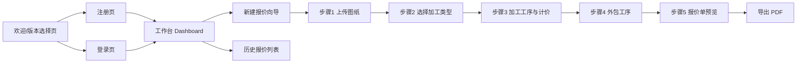

###   Web-LLM-note :   

***

建立一个五金加工行业的，加工费自动计价系统；系统 分成 个人版 和 企业版 分别注册账号
1. 用户注册支持：邮箱 ，手机号码 ；用户账号后期需要接入支付系统，支付后，账户权限和功能变更，这个前期开发阶段不需考虑；
2. 用户登录后，a：上存图纸 （后期可以加入AI分析）初期使用人工代替，b：选择加工的的类型：CNC，车床，激光，其他  c：根据选择的加工类型，生成加工工序，每一个工序，自动加入单价(部分主要特殊加工工序的通过“+”按钮添加工序) ，根据每个工序单价生成总价  d：部分加工需要外包完成，外包工序 ［1 , 2 , 3 , 4 ,...］每个工序独立单价 ，根据需要的工序生成总价；
3. 将所有工序加工价格整合形成 电子文档报价单，.pdf 文档
4. 先根据以上需求文档，建立UI 基本架构，单价数据使用虚拟数据代替，用户数据也使用虚拟数据代替
5.  MVP 阶段使用 HTML CSS JavaScript 原生代码 实现 可以使用轻量级的 CSS 框架对界面UI 进行优化设计 ，不使用 vite npm 等 项目项目管理工具

***

# 五金加工费自动计价系统 · MVP 开发文档

> 版本:v1.0 | 日期:2026-11-16 | 阶段:MVP(纯前端原型)  
> 本文档已对原始需求进行优化与补全,可直接交给 AI 编码工具(vibe code)实施。

---

## 1. 项目概述

### 1.1 项目背景

为五金加工行业建立一套**加工费自动计价系统**。客户上传图纸、选择加工类型后,系统自动生成加工工序清单并按工序单价自动计算总价,最终输出 PDF 电子报价单。

### 1.2 MVP 目标与非目标


| 类别       | 内容                                                          |
| -------- | ----------------------------------------------------------- |
| ✅ MVP 范围 | 双版本注册/登录(个人版/企业版)、图纸上传、加工类型选择、工序自动生成、外包工序计价、报价单预览、PDF 报价单导出 |
| ❌ 暂不实现   | 支付系统接入、账户权限/功能变更、AI 图纸分析(预留入口,初期人工分析)、后端真实存储、短信/邮箱验证码下发、多语言 |


### 1.3 版本定位


|                 | 个人版(Personal)     | 企业版(Enterprise)                 |
| --------------- | ----------------- | ------------------------------- |
| 目标用户            | 个人接单师傅、小作坊        | 加工厂、外贸公司                        |
| MVP 差异化(虚拟数据层面) | 单人操作,报价单带"个人报价"标识 | 预留团队成员/客户列表占位页,报价单带公司抬头、Logo 占位 |
| 注册方式            | 邮箱 或 手机号码         | 邮箱 或 手机号码 + 公司名称(必填)            |


> MVP 阶段两版本共用同一套前端代码,通过注册时选择的 `accountType` 区分展示差异。

---

## 2. 技术方案与约束

### 2.1 技术栈(硬性约束)

- **HTML + CSS + 原生 JavaScript(ES6+)**,单页切换用 JS 控制页面区块显示。
- **不使用** Vite、npm、Node、构建工具、框架(React/Vue 等)。
- 允许使用**轻量级 CSS 框架**优化 UI(推荐二选一,通过 CDN 引入):
  - **Pico.css**(无 class、语义化标签,适合快速原型)或 **Bootstrap 5**(组件丰富,表单/表格更好看)。
  - 图标:可用内联 SVG,不引入图标库构建。
- PDF 生成:**浏览器原生 `window.print()` + `@media print` 打印样式**(将报价单页面打印/另存为 PDF)。不引入 jsPDF 等库,保持零依赖。
- 图表/依赖:**零构建、零 npm**,所有代码可直接双击 `index.html` 运行。

### 2.2 数据与存储(MVP 方案)

- **全部使用前端模拟数据(Mock)**:
  - 用户数据:预置在 `js/mock-data.js` 的虚拟账号数组(如 `demo@personal.com` / `demo@enterprise.com`,密码统一 `123456`)。
  - 工序单价库:预置各加工类型的默认工序及单价(人民币元)。
  - 报价记录:保存至 `localStorage`(key 前缀 `mq_`),刷新不丢失。
- **数据分层设计**:所有 Mock 数据集中在一个数据层文件中,接口形状(字段名、结构)按未来真实后端 API 设计,后期只需替换数据层为 HTTP 请求。

### 2.3 目录结构

```
machining-quote-mvp/
├── index.html          # 单一入口,内含所有页面区块(section 切换)
├── css/
│   └── style.css       # 自定义样式 + @media print 打印样式
├── js/
│   ├── mock-data.js    # 虚拟用户、工序单价库、虚拟图纸分析结果
│   ├── auth.js         # 注册 / 登录 / 会话管理(localStorage)
│   ├── quote.js        # 核心计价流程:图纸上传→选类型→工序→外包→总价
│   ├── pdf.js          # 报价单渲染与打印导出
│   └── app.js          # 路由(区块切换)、初始化
└── README.md
```

---

## 3. 页面与功能规格

### 3.1 页面清单与流程



页面区块(同一 `index.html` 内切换):

1. **欢迎页**:两张版本卡片(个人版 / 企业版),点击进入对应注册或登录。
2. **注册页**:选择版本 → 邮箱或手机号(格式校验)+ 密码;企业版额外要求公司名称。注册成功写入 localStorage 并自动登录。
3. **登录页**:账号(邮箱/手机号)+ 密码,校验预置虚拟账号或已注册账号;提供"一键填充演示账号"按钮。
4. **工作台 Dashboard**:欢迎语、当前版本标识、统计卡片(本月报价单数、报价总金额)、"新建报价"主按钮、历史报价列表(可查看/删除/再次导出 PDF)。
5. **新建报价向导**:5 步向导,顶部步骤条,可上一步/下一步,未完成当前步不能跳步。
6. **报价单预览页**:正式排版的公司抬头/个人信息 + 工序明细表 + 外包明细表 + 汇总,含"导出 PDF"按钮。

### 3.2 功能规格:注册与登录(需求点 1)

- 注册字段:
  - `accountType`:`personal` | `enterprise`(由进入入口决定,页面上可回改)
  - `identifier`:邮箱(正则校验)或手机号(11 位,1 开头校验),二选一,自动识别类型
  - `password`:≥ 6 位
  - `companyName`:仅企业版必填
- 登录成功后写入会话:`localStorage.mq_session = { userId, accountType, loginAt }`。
- **预留设计**:用户对象含 `plan: 'free'` 与 `paidFeatures: []` 字段,注释说明"支付接入后据此变更权限",MVP 不读取该字段做逻辑。

### 3.3 功能规格:图纸上传(需求点 2a)

- 支持点击选择或拖拽上传,接受 `.jpg / .png / .pdf / .dwg / .dxf`,单文件 ≤ 10MB(MVP 仅前端校验,不做真实上传)。
- 上传后显示文件卡片(缩略图占位、文件名、大小、删除按钮),支持多文件。
- **AI 分析占位**:每个文件卡片带"AI 分析(即将上线)"灰色禁用按钮;实际流程为人工代替——点击"人工评估"弹出模态框,预填虚拟分析结果(材质:铝合金 6061、数量:100 件、建议工艺等,来自 mock-data),可编辑后确认,结果进入后续计价上下文(如数量影响总价)。

### 3.4 功能规格:加工类型选择(需求点 2b)

四张可选卡片,单选:


| 类型     | code    | 默认工序(虚拟单价,元)                                               |
| ------ | ------- | ---------------------------------------------------------- |
| CNC 加工 | `cnc`   | CNC 编程 200 / CNC 铣削(每件) 15 / CNC 精加工(每件) 8 / 去毛刺 5 / 质检 10 |
| 车床加工   | `lathe` | 车床编程 150 / 车削(每件) 10 / 切槽 6 / 倒角 4 / 质检 8                  |
| 激光加工   | `laser` | 激光切割(每件) 12 / 折弯(每刀) 3 / 焊接(每条焊缝) 20 / 打磨 5 / 质检 8         |
| 其他     | `other` | 表面处理 30 / 组装 15 / 包装 3 / 质检 10                             |


> 单价均为**虚拟数据**,集中定义在 `mock-data.js` 的 `PROCESS_PRICE_LIBRARY` 中,结构为 `{ type, processes: [{ id, name, unit, price }] }`。

### 3.5 功能规格:工序生成与计价(需求点 2c)

- 选择加工类型后,自动把该类型的**默认工序全部加入工序表**,每行:工序名称、单位、单价(可编辑)、数量(默认 1,可编辑)、小计(单价 × 数量,自动计算)、删除按钮。
- **"+"按钮**:工序表下方有"添加特殊工序"按钮,弹出下拉/模态框,从该类型的**附加特殊工序池**(mock-data 中每个类型额外定义 3\~5 项,如 CNC 类型的"五轴加工 40/件""镜面抛光 25/件")选择添加;也支持"自定义工序"(手输名称与单价)。
- 每次增删改后**实时重算**:工序小计、工序小计合计。
- 合计公式:`工序小计合计 = Σ(各工序单价 × 数量)`,再乘以图纸分析确认的数量折扣系数(虚拟规则:数量 ≥ 50 件打 95 折,≥ 100 件打 9 折,可关闭)。

### 3.6 功能规格:外包工序(需求点 2d)

- 向导第 4 步为"外包工序"页:点击"添加外包工序"逐条添加,每条独立填写:外包项目名称、供应商(可选,虚拟供应商下拉:如"宏达热处理厂""精艺电镀厂")、单价、数量、小计。
- 外包工序编号显示为 \[1\]\[2\]\[3\]\[4\]…,可独立删除。
- 外包小计合计 = Σ(各外包工序单价 × 数量)。
- 允许跳过(无外包)。

### 3.7 功能规格:报价单与 PDF(需求点 3)

- **汇总总价** = 工序小计合计 × 数量折扣 + 外包小计合计(页面上分项展示,公式透明)。
- 报价单预览页排版要素:
  - 抬头:企业版显示公司名称 + Logo 占位;个人版显示"个人加工报价" + 用户名。
  - 单号:自动生成,格式 `QT-YYYYMMDD-XXXX`(随机 4 位)。
  - 日期、客户信息占位、有效期(默认 15 天)。
  - 明细表 A:加工工序(序号、名称、单位、单价、数量、小计)。
  - 明细表 B:外包工序(独立编号、名称、供应商、单价、数量、小计)。
  - 汇总区:工序小计、折扣、外包小计、**含税总价(大写金额 + 数字)**。
  - 底部备注:虚拟联系方式、付款条款占位、"本报价单由加工费自动计价系统生成"。
- **PDF 导出**:点击"导出 PDF"调用 `window.print()`,`@media print` 样式隐藏导航/按钮,仅打印报价单区域,用户在打印对话框选择"另存为 PDF"。文件名建议 `报价单-QT-xxxx.pdf`。
- 保存报价记录到 localStorage 并出现在工作台历史列表。

---

## 4. 数据模型(Mock 数据接口形状)

```js
// 用户
{ id, accountType: 'personal'|'enterprise', identifier, identifierType: 'email'|'phone',
  password, companyName?, plan: 'free', paidFeatures: [], createdAt }

// 工序
{ id, name, unit, price, qty, source: 'default'|'special'|'custom' }

// 外包工序
{ id, index, name, supplier?, price, qty }

// 报价单
{ quoteNo, createdAt, accountType, companyInfo, drawings: [{fileName, size, analysis}],
  processType, processes: [...], discountRate, processesSubtotal,
  outsource: [...], outsourceSubtotal, grandTotal, grandTotalCN }
```

---

## 5. 非功能要求与验收标准

- 兼容 Chrome / Edge 最新版,响应式适配桌面与平板(≥ 768px 优先)。
- 所有金额保留 2 位小数,使用元为单位,注意浮点精度(建议以"分"计算后转换)。
- 表单均有前端校验与错误提示(中文)。
- **验收清单**:
  1. 个人版与企业版均可注册、登录、登出;
  2. 上传图纸(含拖拽)并完成人工评估;
  3. 四种加工类型均可自动生成工序并正确计价;
  4. "+"按钮可添加特殊/自定义工序,删除工序后总价实时更新;
  5. 数量折扣规则生效且可关闭;
  6. 外包工序可添加多条、独立计价、独立删除;
  7. 报价单预览排版完整,打印导出 PDF 正常;
  8. 刷新后历史报价不丢失;
  9. 双击 `index.html` 无需任何构建即可运行。

---

## 6. 后续迭代路线(仅记录,不在 MVP 实现)

1. **V1.1**:接入真实后端(API + 数据库),用户体系上云,验证码下发。
2. **V1.2**:支付系统接入,按 `plan/paidFeatures` 解锁版本功能与配额。
3. **V1.3**:AI 图纸分析(识别尺寸、材质、工艺建议),替代人工评估。
4. **V2.0**:企业版团队协作、客户管理、报价审批流、历史报价对比与统计报表。