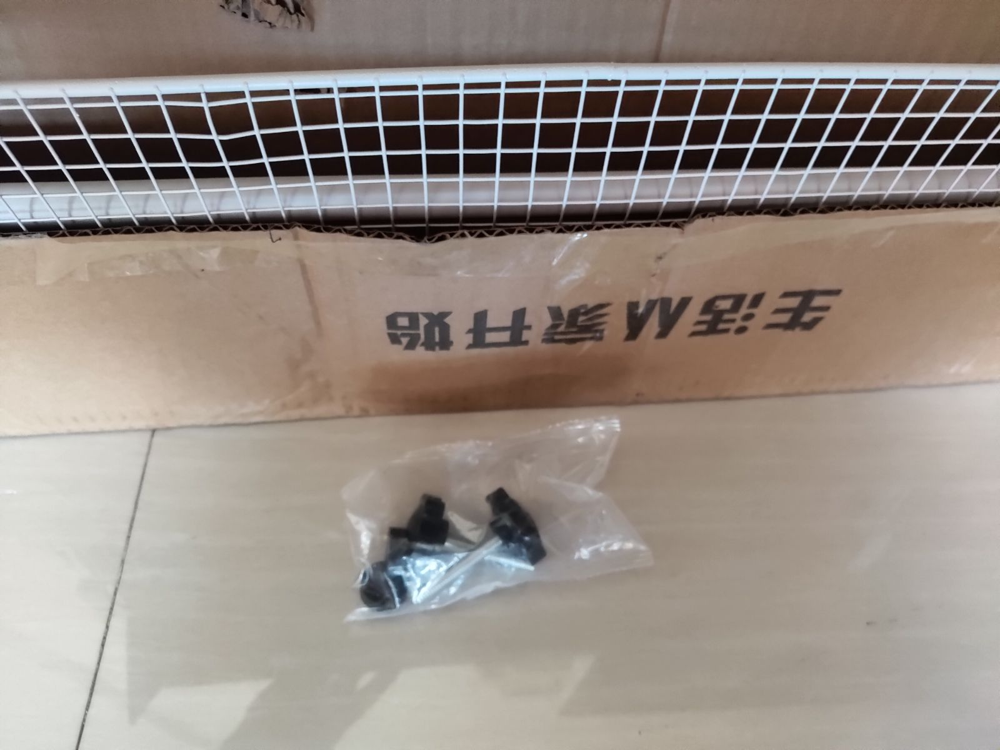

test the  doc

hello world !      

<figure data-image-tier="standard" class="unidoc-block" data-block-id="b-mwx8h6t9-dpaw" data-updated="1795678267581"><figcaption>图片</figcaption></figure>

<figure data-image-tier="standard" class="unidoc-block" data-block-id="b-mwx9e0ml-kppr" data-updated="1795679817646" style="transition: transform 0.16s cubic-bezier(0.2, 0, 0, 1); transform: translate3d(0px, 0px, 0px);"><figcaption>添加图片注释...</figcaption></figure>

<figure data-image-tier="standard" class="unidoc-block" data-block-id="b-mwx8hhr8-nzi8" data-updated="1795681980729" style=""><figcaption>添加图片注释...</figcaption></figure>